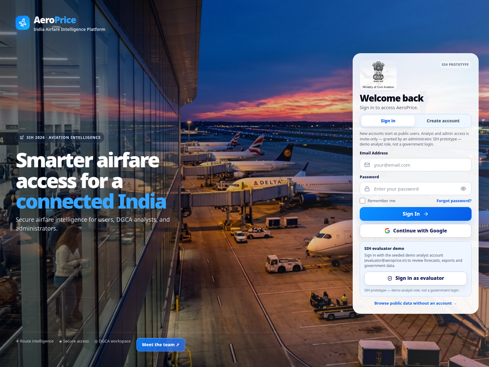
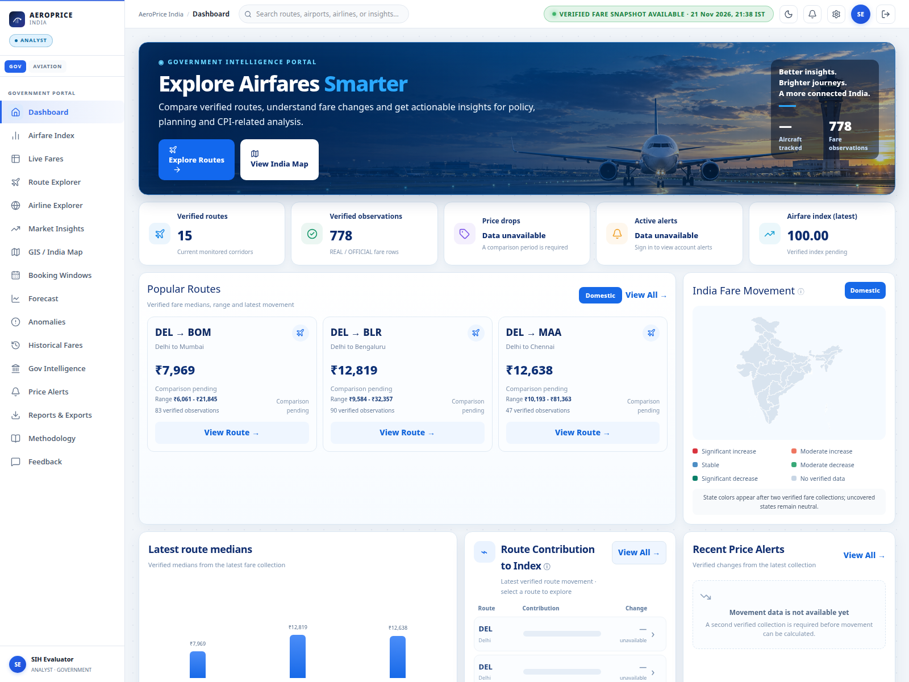
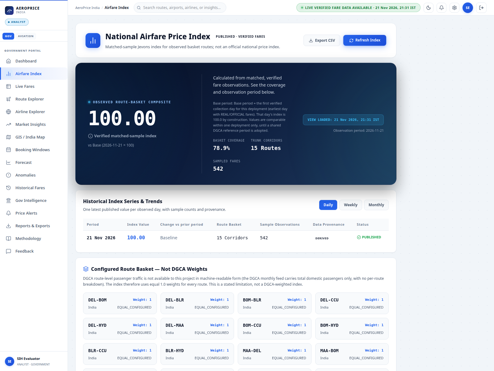
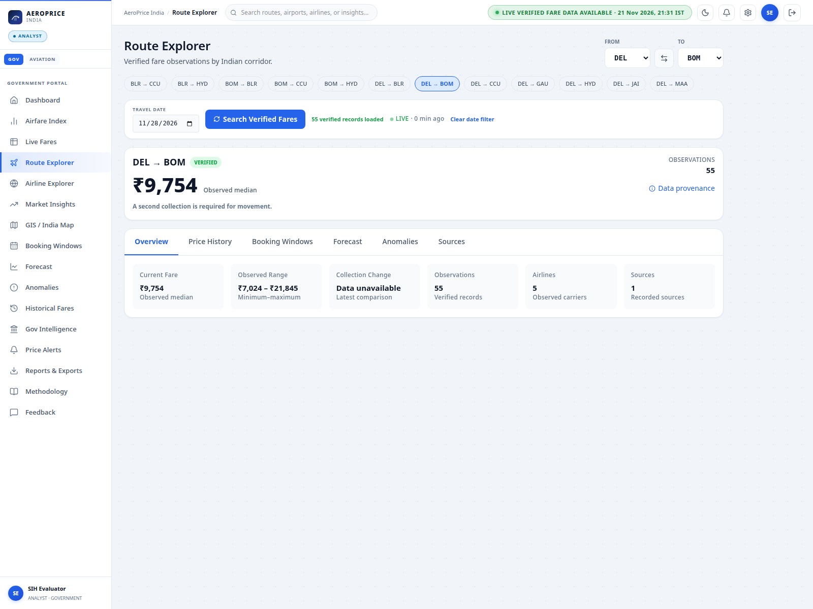
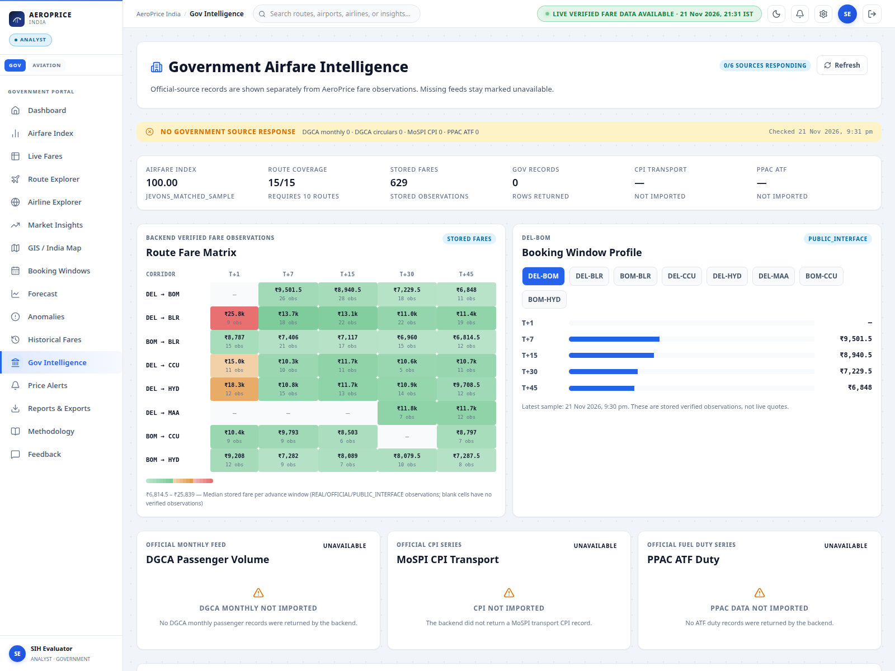
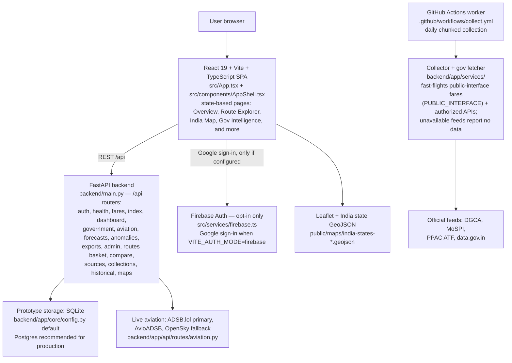

# AeroPrice


> India's airfare intelligence platform for evidence-led decisions across routes, markets, government data, and aviation operations.

AeroPrice is an **SIH 2026 prototype for problem statement SIH26056**. It turns airfare observations and aviation data into a fast, role-aware intelligence workspace for public users, analysts, government stakeholders, and administrators.

> **Status: prototype — live at https://aero-price-production.vercel.app.** One Vercel deployment serves the React SPA and the FastAPI backend (same-origin `/api`). To run it locally, follow [Quick start](#quick-start) below. See [Deployment](#deployment) for how the hosted instance is put together.

> **Not an official Government of India service.** Government, DGCA, and MoSPI references in this project are data-source and methodology references only.

## Screenshots

Captured 21 Nov 2026 from a verified local run of this exact repository (the
Vite frontend against the FastAPI backend on a fresh local database, 542+
real PUBLIC_INTERFACE fares collected live from Google Flights during the
run). Screenshots are re-captured from a local run whenever the UI changes
materially. The pre-21-Nov screenshots were removed because their files were
never committed to the repo and every link was broken.


*Sign-in — the SIH evaluator demo card offers one-click sign-in when the
deployer set `VITE_EVALUATOR_PASSWORD` at build time.*


*Dashboard — 15 verified routes, 778 verified observations, popular-route
medians from the latest collection.*


*Airfare Index — Daily/Weekly/Monthly views, and the "Configured Route
Basket — Not DGCA Weights" card stating the equal-weights limitation.*


*Route Explorer — DEL→BOM, ₹9,754 observed median, 55 verified records.*


*Government Intelligence — the Route Fare Matrix heatmap renders real median
fares per corridor × advance window; blank cells have no verified
observations. Government feeds (DGCA/MoSPI/PPAC) stay honestly marked
unavailable when they do not respond.*

Two further verified captures live in `docs/images/` but are not embedded
here: `06b-route-analysis.png` (Market Insights route list) and
`06c-elasticity.png` (lead-time elasticity curve, DEL–HYD, real data).

## What AeroPrice helps you do

- **See the market at a glance** — an AI-assisted briefing of the latest verified fare movement, opening with what changed, why it matters, and what to inspect next.
- **Compare domestic routes** — median fares, observed ranges, and route-level changes, plus route-basket and side-by-side comparison views.
- **Understand India geographically** — fare movement and aviation map views.
- **Connect price signals to context** — DGCA, MoSPI CPI, PPAC ATF, and data.gov.in references, with source provenance and freshness indicators.
- **Explore live aviation activity** — aircraft, airports, and operational views.
- **Create actionable alerts** — price alerts for routes and price changes.
- **Work with forecasts and anomalies** — forecast, anomaly, and historical views alongside the current picture.
- **Support governance workflows** — exports, audit trails, and role-aware analyst and admin workspaces.

## Product principles

### Evidence first

Verified and official observations stay visibly separate from modeled or AI-assisted interpretation. AI may summarize patterns and suggest where to look; it does not replace the underlying source record.

### Intelligence before complexity

The dashboard opens with a concise brief, followed by the evidence needed to validate it — not a wall of charts.

### Fast first view

The first meaningful dashboard view should arrive quickly from cached, clearly labelled last-known data while live feeds refresh in parallel. The frontend loads only the active workspace instead of initializing every page at startup.

### Honest when data is missing

When no authorized fare provider is configured, the API reports that fares are unavailable rather than inventing observations. Live aviation telemetry uses ADSB.lol with OpenSky fallback. Payment/subscription gates are represented as locked UI until entitlement and payment logic is added.

## Experience direction

The visual system follows the AeroPrice mark: aviation blue, electric cyan accents, deep navy surfaces, glass-like data cards, route-line motifs, and generous information hierarchy. AI-generated or decorative imagery is used only as interface atmosphere; fares, government records, and operational statuses remain data-backed.

## Tech stack

| Layer | Technology |
| --- | --- |
| Frontend | React 19 + Vite + TypeScript |
| Styling & icons | Tailwind CSS v4, Lucide icons |
| Maps | Leaflet / React-Leaflet |
| Auth (user-facing) | Firebase Google Authentication |
| Auth (privileged workspaces) | Backend JWT auth for analyst and admin work |
| Backend | FastAPI (Python) |
| Prototype storage | SQLite; Postgres recommended for production durability |
| Analysis | Hand-rolled pure-Python engines: Jevons matched-sample index, Holt-Winters forecast, z-score anomaly detection (pandas/NumPy/scikit-learn/statsmodels are pinned in requirements but not imported by app code) |

The repository is split in two parts: the Vite frontend at the repository root, and the FastAPI backend in `backend/` (entrypoint `backend/main.py`).

## Architecture

The frontend is a single-page app with client-side routing (`react-router-dom`): `src/App.tsx` renders one page at a time inside `src/components/AppShell.tsx`, and every authenticated page is a `React.lazy` chunk behind `Suspense`, so the first paint ships only the shell + login. Heavy vendor libraries (Leaflet, jsPDF, Firebase) ride in their own chunks via `manualChunks` in `vite.config.ts`. It talks to the FastAPI backend over `/api`, and to Firebase only where that integration is actually wired.



Notes on what is *not* in the diagram: no component is drawn that was not verified in code. The backend issues backend JWT auth by default (`VITE_AUTH_MODE` anything other than `firebase` selects backend auth in `src/contexts/AuthContext.tsx`); Firebase is the opt-in path, not the default. There is no Supabase integration — the dead Supabase client module was deleted on 21 Nov 2026, and price alerts persist server-side via the backend (`price_alerts` table).

## Index methodology

- **Formula:** matched-sample weighted Jevons index, `P_t = Π (p_it / p_i0)^(w_i)` with normalised route weights `Σw_i = 1`, base value 100.0, published only with ≥10 matched corridors × ≥3 observations each (`backend/app/services/index_engine.py`). Daily, weekly (ISO week) and monthly (calendar month) views are served by `/api/index/history?frequency=`.
- **Base period:** the first verified collection day for the deployment — documented in the engine (`BASE_PERIOD_POLICY`) and returned as `base_period_note` on `/api/index/current`. Values are comparable within one deployment only, until a shared DGCA reference period is adopted.
- **Weights — gravity model from AAI traffic (DGCA weights still unavailable):** each route's weight is proportional to `sqrt(passengers at origin × passengers at destination)` from AAI airport domestic-passenger traffic (September 2026, Annexure-III B), normalised to sum 1.0 — e.g. DEL-BOM ≈ 0.097, CCU-IMF ≈ 0.009. This is a modelled proxy for route traffic, not measured DGCA route traffic: DGCA route-level passenger-traffic weights are **unavailable** (the DGCA monthly feed carries total domestic passengers only, with no per-route breakdown), so this is not a DGCA-weighted index. See `backend/app/config/weights.py` and `backend/data/aai/README.md` for the documented config, formula and source. The limitation is shown on the Airfare Index page, not hidden.
- **Data origins:** `REAL`/`OFFICIAL` fares plus `PUBLIC_INTERFACE` fares — real fares collected from the Google Flights public interface via `fast-flights`, honestly labelled, feeding the index under the disclosed SIH-demo methodology (never "GDS fare"). `SANDBOX_TEST` (Amadeus/Duffel test environments) and `GENERATED_TEST` are permanently excluded.
- **Backtest:** the method is implemented in `backend/app/analytics/backtest.py` (monthly Jevons series vs an official benchmark's MoM % changes, with coverage reporting) and exposed at `GET /api/index/backtest`. The live benchmark is the **MoSPI CPI Transport division (All-India Combined, base 2024=100)**, shipped in `backend/data/mospi_cpi_transport.csv` (Jan–Oct 2026, each month sourced from its MoSPI press release, Annexure I). **DGCA gap, stated plainly:** SIH26056 asks for a backtest against "publicly available DGCA monthly average-fare data", but verified 22 Nov 2026, DGCA does not publish monthly average fares anywhere public (the Tariff Monitoring Unit's fare data is internal only) — so the DGCA path (`?benchmark=dgca`) honestly reports `NO_DGCA_DATA` until genuine DGCA fare data is obtained, e.g. via RTI. The MoSPI benchmark is labelled as MoSPI CPI everywhere, never as DGCA data. A full comparison still needs AeroPrice index history (two collection months); until then the endpoint reports the actual coverage window.

## Quick start

### Prerequisites

- Node.js with npm, for the frontend
- Python 3, for the backend

### Frontend

```bash
npm install
npm run dev
```

Open `http://localhost:8443` (the Vite dev server port configured in `vite.config.ts`).

### Backend

```bash
cd backend
python -m venv .venv
source .venv/bin/activate
pip install -r requirements.txt
# SECRET_KEY is required — the app refuses to boot without one:
export SECRET_KEY=$(python -c "import secrets; print(secrets.token_hex(32))")
python -m uvicorn main:app --reload --port 8000
```

On Windows, activate with `.venv\Scripts\activate` instead of `source .venv/bin/activate`.

The backend API then serves on port 8000. The Vite dev server talks to it at `http://localhost:8000` by default; set `VITE_API_URL` only if the backend runs on a different host/port (see [Environment](#environment)). In production the frontend uses same-origin `/api` and `VITE_API_URL` is ignored.

## Environment

### Frontend

Set these in your deployment environment (or a local `.env.local`) as needed:

```bash
# Dev only — the production build uses same-origin /api and ignores this:
VITE_API_URL=http://localhost:8000
VITE_FIREBASE_API_KEY=YOUR_FIREBASE_API_KEY
VITE_FIREBASE_AUTH_DOMAIN=YOUR_FIREBASE_AUTH_DOMAIN
VITE_FIREBASE_PROJECT_ID=YOUR_FIREBASE_PROJECT_ID
VITE_FIREBASE_STORAGE_BUCKET=YOUR_FIREBASE_STORAGE_BUCKET
VITE_FIREBASE_MESSAGING_SENDER_ID=YOUR_FIREBASE_MESSAGING_SENDER_ID
VITE_FIREBASE_APP_ID=YOUR_FIREBASE_APP_ID
VITE_FIREBASE_MEASUREMENT_ID=YOUR_FIREBASE_MEASUREMENT_ID
VITE_FIREBASE_ADMIN_EMAILS=YOUR_ADMIN_EMAILS
```

### Backend

Minimum production-like backend variables:

```bash
ENVIRONMENT=production
SECRET_KEY=<generate-a-long-random-secret>
ALLOWED_ORIGINS=https://YOUR_FRONTEND_DOMAIN
DATABASE_URL=<your-database-url>
```

For local development, the backend validates CORS through `ALLOWED_ORIGINS`, e.g. `ALLOWED_ORIGINS=http://localhost:8443,http://localhost:5173`. Do not use a wildcard `*`.

### Security

Firebase web configuration values are public client identifiers. Never commit service-account JSON, backend passwords, provider secrets, or any credential. `SECRET_KEY` has no default — it must come from the environment in every deployment.

## Roles and access

- **User** — self-registration (email + password) or Firebase Google sign-in creates normal user access (role `PUBLIC`, plan `FREE`).
- **Analyst / DGCA** — admin-granted only. DGCA self-registration is closed; there is no way for a visitor to grant themselves the ANALYST role.
- **Admin** — backend-authorized accounts only, created out of band (`scripts/bootstrap_admin.py`).
- **SIH evaluator** — one seeded account (`evaluator@aeroprice.in`, ANALYST role) created by `backend/app/seed/evaluator.py` with a password from the environment; shared privately with judges, never published.
- **Read vs write:** any signed-in user can view read-only surfaces (forecast, index history/basket, exports, collections reads, source-health). Write/admin actions (collection trigger, anomaly-detection run, government refresh, all `/api/admin/*`) stay gated. See [ACCESS_PLAN.md](./ACCESS_PLAN.md).

## Verification

Build the frontend:

```bash
npm run build
```

Run the backend test suite:

```bash
cd backend
python -m pytest -q
```

(Use the virtual environment's Python; on Windows that is `.venv\Scripts\python.exe -m pytest -q`.)

## Performance notes

The one-second goal applies to the first meaningful frontend view, not an unconditional promise about every backend response. Measure frontend bundle startup, first render, and backend/API cold start separately. Route-level code splitting is implemented (React.lazy pages + vendor manualChunks, landed 21 Nov 2026). Remaining optimizations include cached dashboard snapshots, parallel refreshes, independent timeouts for optional feeds, and production-build measurements on a cold browser cache.

## Deployment

See [DEPLOYMENT.md](./DEPLOYMENT.md) for full deployment guidance: one Vercel deployment serving the Vite frontend and the FastAPI backend together (same-origin `/api`, no separate backend host), the hosted-Postgres requirement, the GitHub Actions collection worker, Firebase authorized domains, and CORS.

---

Built by Thunderdoc
