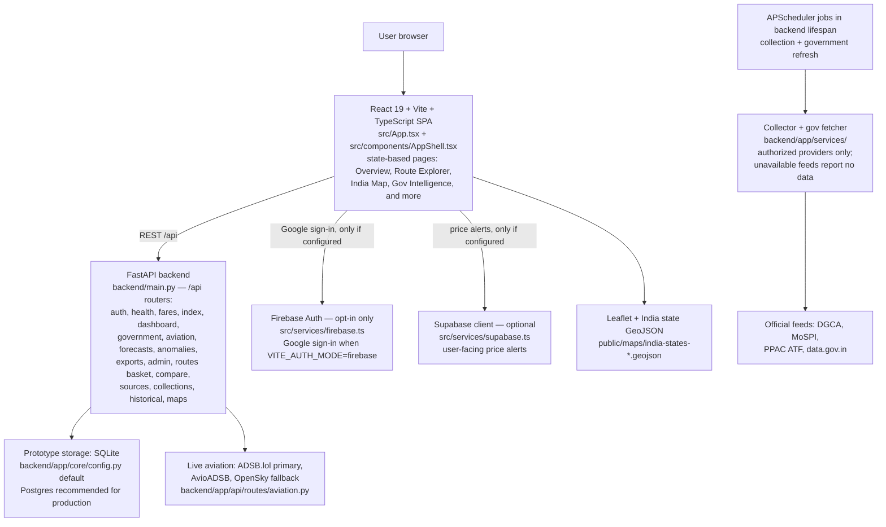

# AeroPrice


> India's airfare intelligence platform for evidence-led decisions across routes, markets, government data, and aviation operations.

AeroPrice is an **SIH 2026 prototype for problem statement SIH26056**. It turns airfare observations and aviation data into a fast, role-aware intelligence workspace for public users, analysts, government stakeholders, and administrators.

> **Status: prototype — no public deployment is listed.** No live demo URL is named anywhere in this repository, so none is claimed here. To run it, follow [Quick start](#quick-start) below. See [Deployment](#deployment) for how a hosted instance is put together.

> **Not an official Government of India service.** Government, DGCA, and MoSPI references in this project are data-source and methodology references only.

## Screenshots

Captured from a local run of this exact repository: the Vite frontend (`npm run dev`, port 8443) against the FastAPI backend on a fresh local database, signed in with locally created test accounts. There is no live deployment, so these are local-run screenshots, not a hosted demo. Because no authorized fare provider is configured in that run, the data panels honestly show the app's empty states ("Data unavailable", "0 routes with stored quotes", "0/6 sources responding") rather than populated figures.


**Sign-in** — the workspace gate: User, DGCA, and Admin tabs over the airport login artwork, with the Ministry of Civil Aviation badge and the SIH Prototype mark.


**User dashboard (Overview)** — hero brief, stat cards (verified routes, verified observations, price drops, active alerts, airfare index), popular routes, and the India fare-movement map. With no provider configured, routes read "Data unavailable — No verified observation for this route yet."


**GIS / India Map** — Leaflet map of India with airport markers. The run shows the honest degraded state: "No verified route observations are available for the map", "0 routes with stored quotes", and "0 flight positions over India — OFFLINE".


**Route Explorer (DEL → BOM)** — verified fare observations by corridor, with travel-date search. Here it reports "No verified fare records are available for DEL-BOM" and 0 observations, rather than inventing a fare.


**Government Intelligence (analyst workspace)** — official-source records kept separate from AeroPrice fare observations. This run shows "0/6 sources responding", "DGCA monthly 0 · DGCA circulars 0 · MoSPI CPI 0 · PPAC ATF 0", and "Index not published".

## What AeroPrice helps you do

- **See the market at a glance** — an AI-assisted briefing of the latest verified fare movement, opening with what changed, why it matters, and what to inspect next.
- **Compare domestic routes** — median fares, observed ranges, and route-level changes, plus route-basket and side-by-side comparison views.
- **Understand India geographically** — fare movement and aviation map views.
- **Connect price signals to context** — DGCA, MoSPI CPI, PPAC ATF, and data.gov.in references, with source provenance and freshness indicators.
- **Explore live aviation activity** — aircraft, airports, and operational views.
- **Create actionable alerts** — price alerts for routes and price changes.
- **Work with forecasts and anomalies** — forecast, anomaly, and historical views alongside the current picture.
- **Support governance workflows** — exports, audit trails, and role-aware analyst and admin workspaces.

## Product principles

### Evidence first

Verified and official observations stay visibly separate from modeled or AI-assisted interpretation. AI may summarize patterns and suggest where to look; it does not replace the underlying source record.

### Intelligence before complexity

The dashboard opens with a concise brief, followed by the evidence needed to validate it — not a wall of charts.

### Fast first view

The first meaningful dashboard view should arrive quickly from cached, clearly labelled last-known data while live feeds refresh in parallel. The frontend loads only the active workspace instead of initializing every page at startup.

### Honest when data is missing

When no authorized fare provider is configured, the API reports that fares are unavailable rather than inventing observations. Live aviation telemetry uses ADSB.lol with OpenSky fallback. Payment/subscription gates are represented as locked UI until entitlement and payment logic is added.

## Experience direction

The visual system follows the AeroPrice mark: aviation blue, electric cyan accents, deep navy surfaces, glass-like data cards, route-line motifs, and generous information hierarchy. AI-generated or decorative imagery is used only as interface atmosphere; fares, government records, and operational statuses remain data-backed.

## Tech stack

| Layer | Technology |
| --- | --- |
| Frontend | React 19 + Vite + TypeScript |
| Styling & icons | Tailwind CSS v4, Lucide icons |
| Maps | Leaflet / React-Leaflet |
| Auth (user-facing) | Firebase Google Authentication |
| Auth (privileged workspaces) | Backend JWT auth for analyst and admin work |
| Alerts persistence | Supabase client support for user-facing price alerts |
| Backend | FastAPI (Python) |
| Prototype storage | SQLite; Postgres recommended for production durability |
| Analysis | pandas, NumPy, scikit-learn, statsmodels |

The repository is split in two parts: the Vite frontend at the repository root, and the FastAPI backend in `backend/` (entrypoint `backend/main.py`).

## Architecture

The frontend is a single-page app with state-based page switching (no router library): `src/App.tsx` renders one page at a time inside `src/components/AppShell.tsx`. It talks to the FastAPI backend over `/api`, and only to Firebase and Supabase where those integrations are actually wired.



Notes on what is *not* in the diagram: no component is drawn that was not verified in code. The backend issues backend JWT auth by default (`VITE_AUTH_MODE` anything other than `firebase` selects backend auth in `src/contexts/AuthContext.tsx`); Firebase is the opt-in path, not the default. Supabase is client-side and inert when its URL/key are unset.

## Quick start

### Prerequisites

- Node.js with npm, for the frontend
- Python 3, for the backend

### Frontend

```bash
npm install
npm run dev
```

Open `http://localhost:8443` (the Vite dev server port configured in `vite.config.ts`).

### Backend

```bash
cd backend
python -m venv .venv
source .venv/bin/activate
pip install -r requirements.txt
python -m uvicorn main:app --reload --port 8000
```

On Windows, activate with `.venv\Scripts\activate` instead of `source .venv/bin/activate`.

The backend API then serves on port 8000. Point the frontend at it with `VITE_API_URL` (see [Environment](#environment)).

## Environment

### Frontend

Set these in your deployment environment (or a local `.env.local`) as needed:

```bash
VITE_API_URL=https://YOUR_BACKEND_HOST
VITE_SUPABASE_URL=https://YOUR_SUPABASE_PROJECT.supabase.co
VITE_SUPABASE_ANON_KEY=YOUR_SUPABASE_ANON_KEY
VITE_FIREBASE_API_KEY=YOUR_FIREBASE_API_KEY
VITE_FIREBASE_AUTH_DOMAIN=YOUR_FIREBASE_AUTH_DOMAIN
VITE_FIREBASE_PROJECT_ID=YOUR_FIREBASE_PROJECT_ID
VITE_FIREBASE_STORAGE_BUCKET=YOUR_FIREBASE_STORAGE_BUCKET
VITE_FIREBASE_MESSAGING_SENDER_ID=YOUR_FIREBASE_MESSAGING_SENDER_ID
VITE_FIREBASE_APP_ID=YOUR_FIREBASE_APP_ID
VITE_FIREBASE_MEASUREMENT_ID=YOUR_FIREBASE_MEASUREMENT_ID
VITE_FIREBASE_ADMIN_EMAILS=YOUR_ADMIN_EMAILS
```

### Backend

Minimum production-like backend variables:

```bash
ENVIRONMENT=production
SECRET_KEY=<generate-a-long-random-secret>
ALLOWED_ORIGINS=https://YOUR_FRONTEND_DOMAIN
DATABASE_URL=<your-database-url>
```

For local development, the backend validates CORS through `ALLOWED_ORIGINS`, e.g. `ALLOWED_ORIGINS=http://localhost:8443,http://localhost:5173`. Do not use a wildcard `*`.

### Security

Firebase web configuration values are public client identifiers. Never commit service-account JSON, backend passwords, provider secrets, or Supabase service-role keys.

## Roles and access

- **User** — Firebase Google sign-in creates normal user access.
- **Admin (frontend)** — only for emails listed in `VITE_FIREBASE_ADMIN_EMAILS`.
- **Analyst / Admin (privileged workspaces)** — require backend-authorized accounts via backend JWT auth.

## Verification

Build the frontend:

```bash
npm run build
```

Run the backend test suite:

```bash
cd backend
python -m pytest -q
```

(Use the virtual environment's Python; on Windows that is `.venv\Scripts\python.exe -m pytest -q`.)

## Performance notes

The one-second goal applies to the first meaningful frontend view, not an unconditional promise about every backend response. Measure frontend bundle startup, first render, and backend/API cold start separately. Planned optimizations include route-level code splitting, cached dashboard snapshots, parallel refreshes, independent timeouts for optional feeds, and production-build measurements on a cold browser cache.

## Deployment

See [DEPLOYMENT.md](./DEPLOYMENT.md) for full deployment guidance: deploying the Vite frontend and the FastAPI backend separately (Vercel/Netlify for the frontend, a FastAPI host for `backend/`), pointing the frontend at the backend with `VITE_API_URL`, Firebase authorized domains, and CORS.

---

Built by Thunderdoc
